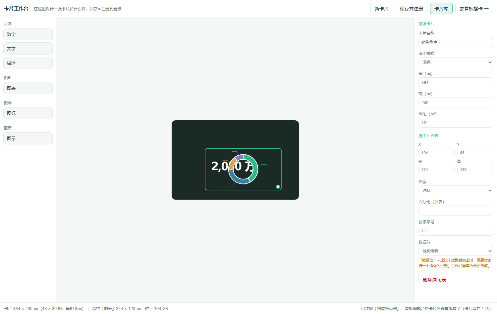
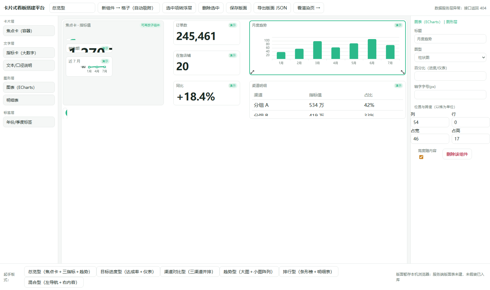
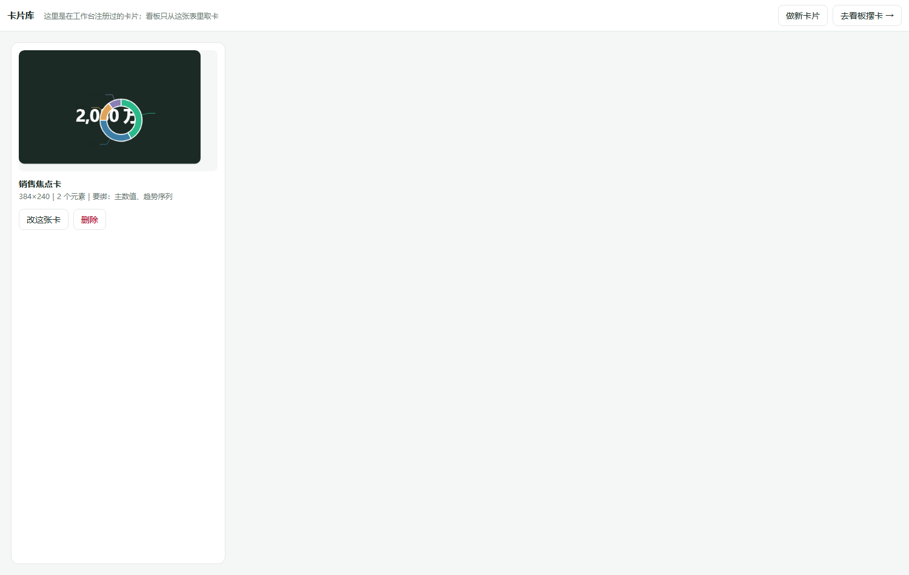

# bi-card-studio · 卡片式 BI 看板搭建平台

一个**先做卡片、再拼看板**的可视化搭建器：在卡片工作台里设计一张卡片长什么样（多大、放哪些元素、
哪几处是数据位），保存即注册进卡片库；在看板编辑台里把已注册的卡拉上版面、给数据位绑上指标，
页面自动取数呈现。桌面大屏与手机端各出一套排法，不是把电脑版缩小。

与多数看板工具的区别：卡片是**可复用的注册物**，不是每次现搭的一次性方块。同一张「月度出库额」卡
可以被拉到十个看板上，绑不同的指标；缩放卡片只改显示逻辑，内部元素结构一律不变。

## 功能矩阵 / Feature Matrix

| 功能 | 说明 |
|---|---|
| 卡片工作台 Card Studio | 单卡设计：选底座样式、摆元素、标数据位；拖拽吸附可见（拖起出网格、落点框带坐标数字、松手吸到 8px 整格回弹） |
| 卡片库 Card Library | 保存即注册；列表预览、改、删；按 id 可回载入工作台继续改 |
| 看板编辑台 Board Editor | GridStack 格制画布（100 列），拖拽吸附、拖角改跨度、属性面板、六套起手板式 |
| 渲染页 View | 按版面 JSON 还原；窄屏按断点换列数纵向重排 |
| 元素与底座分离 | 底座样式（白卡／描边／浅底／深色／渐变）与元素（数字／文字／描述／图表／图标／图示）各是独立清单 |
| 真图表组件 | 本地打包 ECharts，柱／条／折／扇形／圆环／进度／仪表／K线／树状／热力／表格，不引 CDN |
| 消费方配置注入 | 数据前缀、端点清单、凭证头名与存储键全部来自 `public/consumer.config.js`；平台不写死任何一家的地址 |
| 交付判据脚本 | 两条真渲染断言链（编辑台 16 条、工作台 19 条）：不是「页面 200 就算过」，而是元素真的画出来了、字号真的随容器缩放了、图表实例没有泄漏 |

## 长什么样 / Screenshots

以下四张均为本仓构建产物真实运行截图（`npm run build` 后由交付判据脚本驱动浏览器拍摄，非设计稿）：

| 卡片工作台 | 看板编辑台 | 卡片库 | 手机端渲染 |
|---|---|---|---|
|  |  |  |  |

截图里的数值带「演示」标识或显示取数失败的原因——本仓附的是示例配置，没有真实数据服务，
这正是平台应有的表现（不拿假数冒充真数）。

## 快速开始 / Quick Start

```bash
cd 搭建器
npm ci          # 依赖：echarts + gridstack + vite（见 package.json）
npm run build   # 产出 dist/，四个页面各自入口
python -m http.server 8080 --directory dist   # 或 npx vite preview
```

打开 `http://127.0.0.1:8080/studio.html` 就能开始摆卡片。本项目**未发布到 npm**，请按上面的方式取用。
开发模式：`npm run dev`（Vite，改动即时生效）。

跑交付判据（需要本机有 Python 与 Playwright 的浏览器内核）：

```bash
python 搭建器/tests/verify_studio.py     # 工作台侧 19 条
python 搭建器/tests/verify_builder.py    # 看板侧 16 条
# 想验已部署的站点：脚本支持 x <预览站基址>，会自证页面引用的是本次构建资产
```

## 两步走的产品模型

1. **设计卡片**（`studio.html`）：先选底座，再往格子里放元素，给需要数据的位置标上数据位
   （主数值／副说明／趋势序列／分类名）。保存 = 注册进卡片库。
2. **拼看板**（`index.html` → `view.html`）：把注册过的卡拉上版面、拖角改跨度，选每个数据位绑哪个指标，
   取数由平台按消费方配置发起。缩放卡片只改显示比例，元素结构不变。

卡片本身按三条轴组合，互不绑死：**类型**（普通／翻转／拆分／横滑——这是功能形态，不是皮肤）、
**底座样式**（白卡／描边／浅底／深色／渐变）、**动效**（怎么动）。当前版本只实现了「普通」类型，
其余类型与动效库仍在开发中（见文末「已知边界」）。

## 消费方接入 / Consumer contract

平台不认任何具名消费方。换一家使用，只换配置文件，代码零改动：

```js
// 搭建器/public/consumer.config.js —— 仓内附的是示例占位内容
window.BI_CONSUMER = {
  name: "example-consumer",
  apiBase: "/example-bi-api",           // 数据服务前缀
  credHeader: "X-Example-Cred",          // 身份凭证的请求头名
  credKey: "example-login:cred:v1",      // 凭证在使用方站点内的存储键
  endpoints: [
    { key: "overview", label: "总览", path: "/overview" },
    { key: "channels", label: "分组对比", path: "/channels" }
  ]
}
```

- 属性面板里的「端点」下拉、界面显示的中文标签，都来自这张清单，平台不写死端点名。
- 缺 `apiBase`／`credHeader`／`endpoints` 任一项，平台**拒绝取数并如实报错**，不回落默认地址、不猜路径
  （fail-closed）。字段细则见 `docs/CONSUMER-CONTRACT.md`。
- 主题令牌在 `src/tokens.css`，目前是内置默认主题；「由消费方注入主题包」尚在开发中。

## 权限与数据纪律（设计约束，不是缺陷）

- 平台**不判权限**。判定发生在使用方的数据服务层，逐次生效。
- 服务端返回 `***`（无权限）时，前端原样显示，不补零、不猜数、不做前端兜底。
- 未登录、身份未识别、无该模块权限、服务不可达四类失败**分开报**，界面说清是哪一种。
- 取不到数就显示取不到数，绝不画假图。演示模式的数据必须在界面上带「演示」标识。

## 技术底座

GridStack 14（MIT）做看板格制画布；卡片工作台用自研吸附引擎（`src/snap.js`，步长 8px）而不是 GridStack，
因为单卡设计需要「拖起出网格＋落点显示坐标」这种可感知的反馈；图表 ECharts 5 本地打包；构建 Vite 5；
缩放走容器查询单位 `cqw`，配合 `prefers-reduced-motion` 降级为静态。

## 已知边界（如实声明，别当成已完成）

- **存储只在浏览器**：卡片注册表与版面 JSON 落本机 localStorage，服务端表未建，换机或清缓存即丢。
- **登录态真值未实测**：取数链路、四类失败的文案分流都跑过，但「登录后取到真数」需在你们的环境里验收。
- **看板那一步未接通**：编辑台仍是「组件直接摆看板」的形态，「拉注册卡 → 绑指标」这条链未接通，
  整卡缩放渲染器已就位但没接进编辑台。
- **只有普通卡**：翻转卡、拆分卡、横滑卡三种类型未实现；卡片存储还需要「面」这一层。
- **动效库未做**：动效选择、悬停即演的画廊页均未实现。
- **批量与联动未做**：卡片导入导出、卡间联动、全局筛选栏、画布尺寸预设均为规划中。

## License 与第三方

MIT（见 `LICENSE`）。本项目与 GridStack、ECharts、Vite 各无隶属关系；所用三方库均按其自身许可证使用
（GridStack、ECharts、Vite 皆为 MIT），ECharts 本地打包、不引用 CDN。仓内示例端点与演示标签均为占位，
不含任何真实业务数据。
